<p>
  <a href="https://themoiz.com"></a>
  <a href="https://www.linkedin.com/in/moiz-khan-jadoon-62620a210/"></a>
  <a href="https://www.upwork.com/freelancers/~01c3656cbb4b14d090"></a>
  <a href="mailto:kmuizz319@gmail.com"></a>
  
</p>

### `$ whoami`

I build **high-performance web & mobile products** and ship **AI-powered MVPs** fast, from the first wireframe to the App Store.
Most of my work lives at the intersection of **React Native, Next.js, FastAPI and LLMs**.

```ts
const moiz = {
  role:        "Lead Full-Stack & AI MVP Engineer",
  mobile:      ["React Native", "Expo", "NativeWind"],
  web:         ["Next.js", "React", "TypeScript", "Tailwind"],
  backend:     ["FastAPI", "Django", "GraphQL", "PostgreSQL", "Supabase"],
  ai:          ["OpenAI", "Vision models", "Gemini", "LLM agents"],
  payments:    ["Stripe", "RevenueCat"],
  openTo:      "Lead engineering & AI integration work",
  replyTime:   "< 24 hours",
};
```

### `$ ls ./stack`

| Area | Tools |
|---|---|
| **Mobile & Web** |  |
| **Backend & Data** |  |
| **Cloud & Tools** |  |
| **AI & Payments** |      |

### `$ cat ./shipped.md`

| Product | What it does |
|---|---|
| 🤖 **AI Mock Interview Platform** | Practice tech interviews with an AI coach, streamed answers and instant analytics (web + mobile) |
| 🥗 **AI Health & Nutrition App** | Scan food with computer vision, track nutrition, subscription billing |
| 💇 **Real-Time Stylist Marketplace** | Live booking for same-day hairstylist slots |
| 📊 **Enterprise SaaS Dashboard** | Multi-tenant analytics that writes executive summaries with LLMs |
| 🛍️ **AuraShop AI** | E-commerce with an OpenAI style advisor and Stripe checkout |
| 📍 **Family Safety App** | Live location, geofencing and SOS alerts |

👉 Full case studies on **[theMoiz.com](https://themoiz.com)**

### `$ git log --stats`


<p>
  
  
</p>


